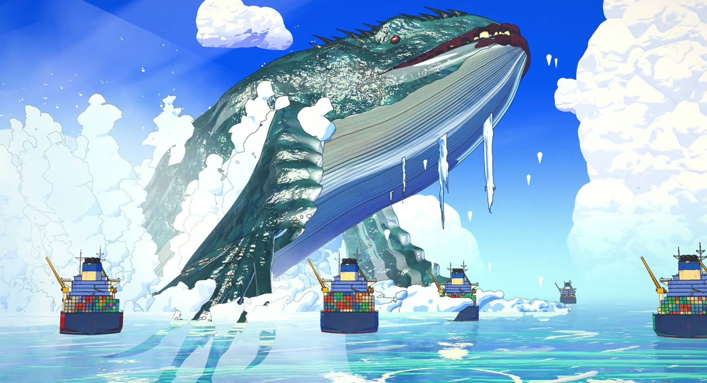
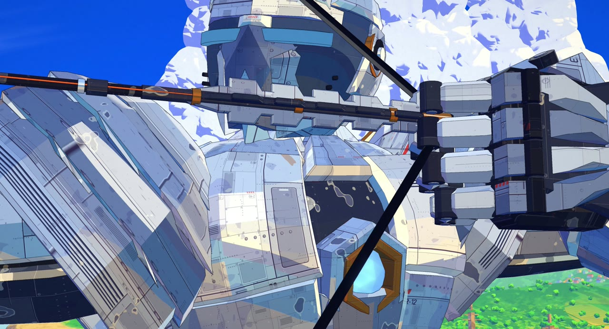
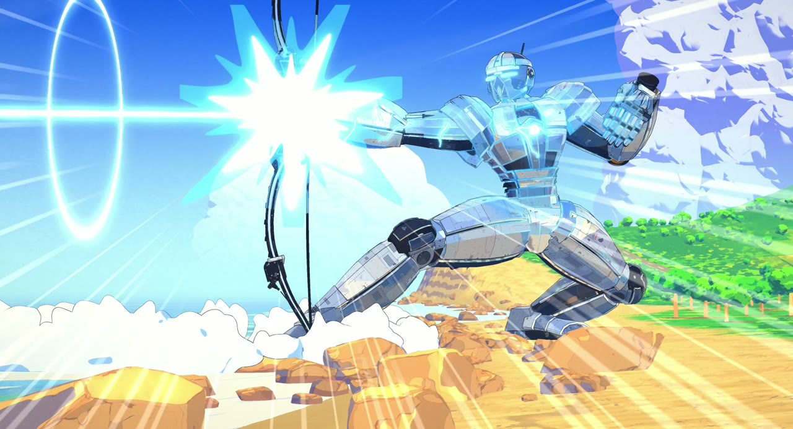
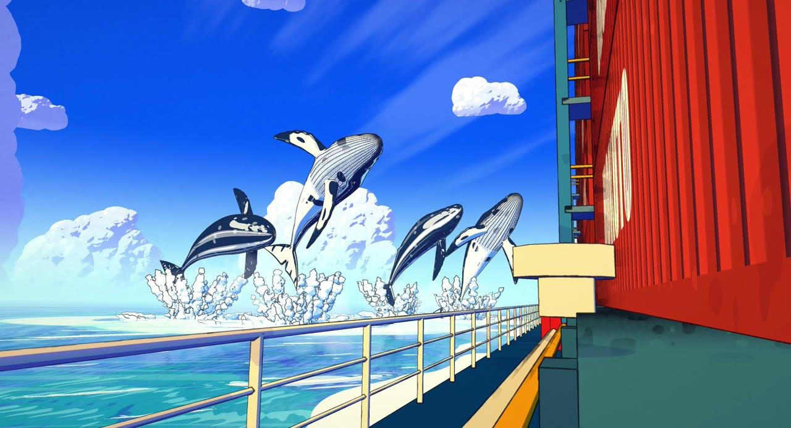
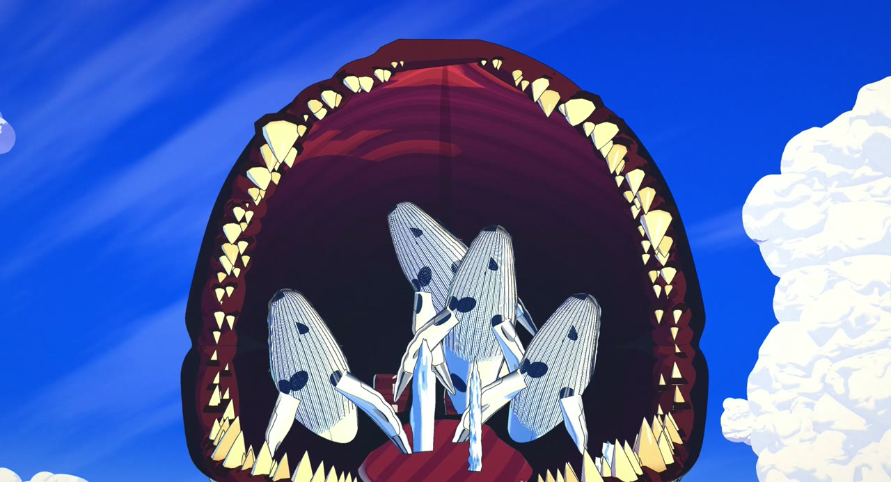
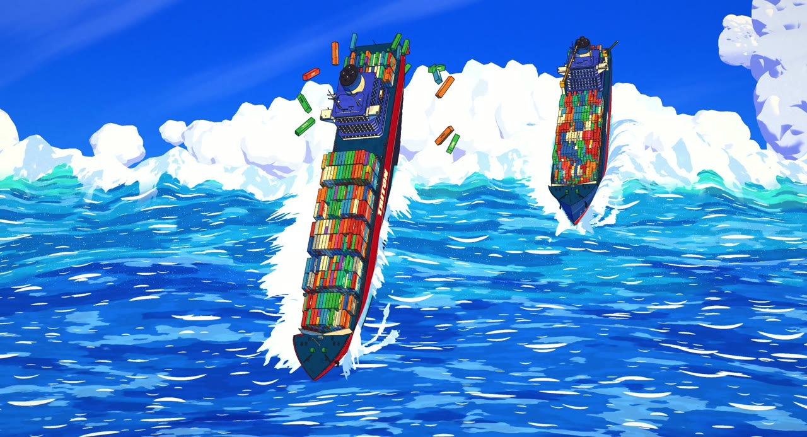
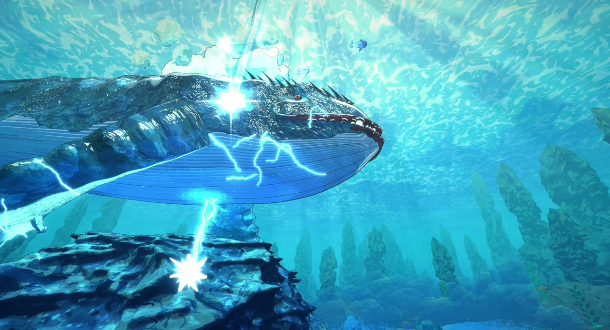

# LEVIATHAN · リヴァイアサン

An 83-second anime short where every frame is rendered by code: no video model, no image model, no hand-drawn frames.
A colossal archer draws a giant bow on a sunlit coast and fires a harpoon that climbs into orbit. Out at sea, four whales
rise beside a fleet of container ships. They are lures inside the mouth of a leviathan. The harpoon comes back down from
space, drives through the beast in a storm of lightning, and the sea takes the fleet.



| | |
|---|---|
|  |  |
|  |  |
|  |  |

**Watch:** download `dist/leviathan_lite.html` (or the full-quality `leviathan.html` and the MP4 from the
[Releases](../../releases)) and open it in any browser. It is one self-contained file and works offline.

> An anime-style remake of a short by ★ AHMII ★: same story and shots, redrawn bright in cel style, with original
> music. Not affiliated. Made with [Claude Code](https://claude.com/claude-code).

---

## How it looks like anime

The film is a three.js (r170, WebGL2) scene drawn through a custom multi-pass pipeline that imitates a cel +
painted-background production, the same engine as [Sunshower](https://github.com/0xCodez/sunshower):

| Pass | What it does |
|---|---|
| shadow / reflection | character-only shadow map (painted lighting, not physics); mirrored camera for the water |
| main (MRT) | colour + a data buffer (view normal, depth, material id) |
| paint | depth-aware Kuwahara "brush" filter on background pixels only → gouache look |
| ink | hand-inked lines on cel pixels only: id / depth / normal edges, pressure noise |
| water | screen-space sea at kilometre scale: swell, whitecaps, reflections, glitter, foam |
| atmosphere | haze, spray, light shafts |
| overlay | drawn energy, lightning and water FX |
| bloom / grade | glow on emissives, high-key anime grade, film grain |

* **Everything is 3D under the drawing.** The archer is built from convex armour plates with projected panel lines,
  the leviathan is a bent skinned surface with a procedural hide, the ships are instanced containers on a hull.
* **Animation is on twos and threes**, like film anime: characters at 12 drawings a second, water FX at 8.
* **Every frame is a pure function of time.** Frames can render in any order, so the headless render is resumable and
  deterministic.
* **Sound is fully synthesized** with Web Audio `OfflineAudioContext`: brass, strings, sub drones, whale song, the
  bowstring, sonic booms, thunder and the sea, all locked to the story beats (`CUES` in `src/shots.js`).

## How it was made

One director session and parallel agent teams in Claude Code, working from a shared production bible
([CONTRACT.md](CONTRACT.md)): archer, leviathan, ships, world, underwater, energy FX, water FX, sound. Each team owned its
own files and rendered stills to check its shots against the reference.

## Run it

Requirements: Node 18+, Google Chrome (or set `CHROME=/path/to/chrome`), and `ffmpeg` on `PATH`.

```bash
npm install
```

Serve the folder with any static server and open `index.html?scale=1` to scrub through the film live:

```bash
npx serve .
```

Render stills for review:

```bash
node tools/snap.mjs --scale 1 s:breach t:41 "q:test=1&cam=0,60,300&at=0,60,0&t=10=name:mycam"
```

Full build: soundtrack, film (resumable segments), single-file player in `dist/`:

```bash
npm run build
```

## Layout

```
src/shots.js        story beats (CUES), the 39 shots, cameras registry
src/cams/           cameras and looks for each department's shots
src/archer*.js      the archer, bow; src/arrow.js the harpoon arrow; src/tether.js its cable
src/leviathan.js    the monster + lev-*.js (body, hide, limbs, spine, whales, animation)
src/ships*.js       container ships, deck, bridge, the giant swell
src/world*.js       sky, ocean, coast, planet, port  (+ bgmaterials.js, passes-env.js)
src/under*.js       the underwater world and its staging
src/fx-energy*.js   charge, lightning, sky tear, plasma
src/fx-splash*.js   breach water, plumes, the water mountain, the crash
src/audio*.js       the synthesized soundtrack
tools/              snap (stills), render (MP4), render-audio (WAV), build-player (HTML), check
player/player.html  the single-file player template
```
